# Agents (`agents.md` / `AGENTS.md`)

Muse Code reads this file as project rules and multi-step agent definitions when running in `/Users/dixitpatel/Documents/Personal-Dev-Workspace/Meta_hackathon/workspace`.

## Global Rules
- Read `agents.md`, `skills.md`, `workstreams.md`, `muse.config.json`, and the active workstream file under `workstreams/` before any action.
- Execute **ONE** workstream at a time, in order (`WS-01` / `W1` $\rightarrow$ `WS-02` / `W2` $\rightarrow$ `WS-03` / `W3` $\rightarrow$ `WS-04` / `W4` $\rightarrow$ `WS-05` / `W5` $\rightarrow$ `WS-06` / `Verify`). Never skip exit criteria.
- Follow the **Plan $\rightarrow$ Implement $\rightarrow$ Test $\rightarrow$ Review $\rightarrow$ Fix** loop (maximum 5 iterations per workstream) until all acceptance tests pass.
- Never edit `.env`, never push/commit without approval, and always run in **Standard mode** (`--contributor-mode off` — never train models on AlphaGenome outputs or NCBI text).
- After each workstream, update `.muse/state.json`, log provenance in `workstreams/trajectories/event_log.jsonl`, and summarize changes before stopping for approval.

---

## Agent Roster

### Planner
- **File**: `.muse/agents/planner.md`
- **Role**: Reads the target workstream specification (`workstreams/W*.md`) and contracts (`workstreams/contracts/`), inspects the target repository without modifying code, and breaks the workstream goal into numbered tasks with exact file paths, risks, and test commands.

### Implementer
- **File**: `.muse/agents/implementer.md`
- **Role**: Writes minimal, pattern-conforming code in the target repository (`genome-nexus`, `alphagenome-sidecar`, `cbioportal-frontend`, or `genome-nexus-frontend`) to satisfy the Planner's task list and the workstream contract.

### Tester
- **File**: `.muse/agents/tester.md`
- **Role**: Executes native repository build, lint, and unit/acceptance test commands using the pinned host toolchains, writes missing unit tests, and reports failures verbatim for the Implementer fix loop.

### Reviewer
- **File**: `.muse/agents/reviewer.md`
- **Role**: Reviews `git status` and `git diff` against the workstream contract (`workstreams/contracts/`), checks compliance rules (`alphagenome-terms`, `ncbi-etiquette`), and blocks completion if any critical issue, schema mismatch, or test failure remains.

### Debugger
- **File**: `.muse/agents/debugger.md`
- **Preset**: `../agentic-setup/presets/genome_nexus_debugger_agent.md`
- **CLI Runner**: `../agentic-setup/bin/muse-debugger` / `../agentic-setup/bin/pipeline_monitor.py`
- **Role**: Specialized Genome Nexus, AlphaGenome & cBioPortal Integration Debugger & Live Pipeline Monitor. Observes Phase 1–7 execution logs, diagnoses liftover / VCF normalization anomalies, evaluates cBioPortal dual-gate criteria, and answers inter-agent queries while Planner, Implementer, and Tester work.

### Verifier
- **File**: `.muse/agents/verifier.md`
- **Preset**: `../agentic-setup/presets/genome_nexus_verifier_agent.md`
- **CLI Runner**: `../agentic-setup/bin/muse-verify`
- **Engine**: `../agentic-setup/bin/verifier_engine.py`
- **Role**: Specialized Cross-Repository Verification & Performance Benchmark Agent. Verifies critical sections across Task A (Genomic Normalization & Liftover), Task B (Sidecar Logic & Canonical Gene Tidy), and Task C (Scaling, Concurrency & Client Batch Streaming). Benchmarks cohort performance on the TCGA PAAD (158 variants) dataset and generates comprehensive, explanatory verification reports.

### PR Agent
- **File**: `.muse/agents/pr_agent.md`
- **Preset**: `../agentic-setup/presets/genome_nexus_pr_agent.md`
- **CLI Runner**: `../agentic-setup/bin/muse-pr`
- **Engine**: `../agentic-setup/bin/pr_manager.py`
- **Role**: Analyzes commit history against base branch, squashes workstream commits into 1 clean commit under user direction, reviews and aligns code conventions and comment styles (intent vs changelogs), and generates structured, precise PR descriptions for reviewers.


---

## Multi-Step Workstream Pipeline (`workstreams.md` & `workstreams/`)

```mermaid
flowchart LR
  O["Muse Code Orchestrator"] --> P["Plan: WS-01..WS-06<br/>contract: alpha_genome schema + sidecar OpenAPI"]

  P --> W1["WS-01 (W1) · Liftover and REF check<br/>genome-nexus · Java<br/>skill: liftover-refcheck"]
  W1 --> W2["WS-02 (W2) · AlphaGenome variant scoring<br/>alphagenome-sidecar · Python<br/>skill: alphagenome-sidecar"]
  W2 --> W3["WS-03 (W3) · alpha_genome field and cache<br/>genome-nexus · Java<br/>skill: genome-nexus-enricher"]
  W3 --> W4["WS-04 (W4) · Annotation cell and hover view<br/>cbioportal-frontend · TypeScript<br/>skill: cbioportal-annotation-cell"]
  W4 --> W5["WS-05 (W5) · Variant Page view<br/>genome-nexus-frontend · TypeScript<br/>skill: variant-page-view"]
  W5 --> T["WS-06 (Verify) · Acceptance tests pass<br/>skill: verify-pipeline"] --> R["Human review · draft PRs"]
```



---

## Pinned Host Toolchains & Repository Commands

Always prepend the pinned toolchains when running terminal commands:

```bash
export PATH="/Users/dixitpatel/Documents/Personal-Dev-Workspace/Meta_hackathon/agentic-setup/bin/node-v22.18.0-darwin-arm64/bin:/Users/dixitpatel/Documents/Personal-Dev-Workspace/Meta_hackathon/agentic-setup/.venv/bin:/opt/homebrew/bin:$PATH"
```

| Repository | Language / Stack | Build Command | Test Command |
| :--- | :--- | :--- | :--- |
| `alphagenome-sidecar/` | Python 3.13 / FastAPI | `pip install -e ".[dev]"` | `pytest -v` |
| `genome-nexus/` | Java 11 / Spring Boot / MongoDB | `JAVA_HOME=/opt/homebrew/opt/openjdk@11/libexec/openjdk.jdk/Contents/Home mvn test-compile -DskipTests -B` | `JAVA_HOME=/opt/homebrew/opt/openjdk@11/libexec/openjdk.jdk/Contents/Home mvn test -pl model,component,service -B` |
| `genome-nexus-annotation-pipeline/` | Java 21 / Spring Batch / Maven | `JAVA_HOME=/opt/homebrew/opt/openjdk@21/libexec/openjdk.jdk/Contents/Home mvn test-compile -DskipTests -B` | `JAVA_HOME=/opt/homebrew/opt/openjdk@21/libexec/openjdk.jdk/Contents/Home mvn test -B` |
| `cbioportal-frontend/` | TypeScript / React 18 / pnpm 10.33.0 | `pnpm --filter react-mutation-mapper run build` | `pnpm run testPackages` |
| `genome-nexus-frontend/` | TypeScript / React 16 / Yarn 1.22.22 | `yarn build` | `CI=true yarn test --watchAll=false` |
