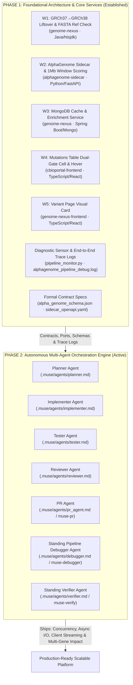

# AlphaGenome Integration: Two-Phase Project Architecture

**Harness**: Meta Muse Code CLI (`/Users/dixitpatel/Documents/Personal-Dev-Workspace/Meta_hackathon/agentic-setup/bin/muse` v1.4.13)  
**Workspace Root**: `/Users/dixitpatel/Documents/Personal-Dev-Workspace/Meta_hackathon/workspace`  
**Session Compliance Mode**: Standard Mode (`--contributor-mode off` — never train on AlphaGenome outputs or NCBI text)

---

## High-Level Vision: Phase 1 vs. Phase 2



---

## Phase 1: Foundational Integration & Verified Services (Bedrock)

Phase 1 established the end-to-end integration contracts, data structures, and baseline implementations across all four repositories:

1. **`W1` Liftover & Normalization**: GRCh37 $\rightarrow$ GRCh38 coordinate liftover via `htsjdk LiftOver`, MAF indel anchoring & left-alignment, GRCh38 FASTA `REF` verification, and canonical gene selection.
2. **`W2` AlphaGenome Sidecar**: FastAPI `POST /score` wrapping DeepMind's AlphaGenome 1 Mb sequence context, canonical gene score tidying (BSON 16MB protection), merged splicing formulas, and UBERON tissue mapping.
3. **`W3` Genome Nexus Enricher & MongoDB Persistence**: Post-enrichment pipeline, persistent `alphagenome.annotation` MongoDB cache, and `CachedAlphaGenomeFetcher`.
4. **`W4` cBioPortal Clinical Annotation Cell**: Mutations Table `AlphaGenomeCell` in Mutation Mapper, dual-gate scoring criteria ($|\text{quantile}| \ge 0.99$, raw score thresholds), and UBERON tissue selector.
5. **`W5` Genome Nexus Frontend**: Variant Page visual card on `:3088`.
6. **Diagnostic Sensor & Observability**: Unified Phase 1–7 logging (`alphagenome_pipeline_debug.log`) and real-time command-line sensor (`pipeline_monitor.py`).

---

## Phase 2: Autonomous Multi-Agent Orchestration Engine

Phase 2 uses Phase 1's contracts, services, and live logging infrastructure as an immutable bedrock. Instead of manual code changes, specialized autonomous agents collaborate in repository loops to plan, implement, test, review, and ship advanced capabilities:

| Agent | Specification | Phase 2 Responsibility |
| :--- | :--- | :--- |
| **Planner** | [`.muse/agents/planner.md`](../.muse/agents/planner.md) | Ingests workstream plans, breaks requirements into atomic repository tasks against contract schemas. |
| **Implementer** | [`.muse/agents/implementer.md`](../.muse/agents/implementer.md) | Sandboxed repository coder; writes minimal pattern-conforming code and unit tests within repo boundaries. |
| **Tester** | [`.muse/agents/tester.md`](../.muse/agents/tester.md) | Executes native builds on pinned toolchains (Java 11, Node 22, Python 3.13), enforcing zero regressions. |
| **Reviewer** | [`.muse/agents/reviewer.md`](../.muse/agents/reviewer.md) | Verifies PR diff against contract schemas, style guidelines, and compliance (AlphaGenome terms, NCBI etiquette). |
| **PR Agent** | [`.muse/agents/pr_agent.md`](../.muse/agents/pr_agent.md) | Squashes feature branches, formats conventional commit summaries, and stages pull requests (`muse-pr`). |
| **Debugger** | [`.muse/agents/debugger.md`](../.muse/agents/debugger.md) | **Standing 6th Agent**: Live-monitors trace logs and uses `pipeline_monitor.py` to diagnose issues for other agents in real time. |
| **Verifier** | [`.muse/agents/verifier.md`](../.muse/agents/verifier.md) | **Standing 7th Agent**: Authoritative cross-stack arbiter; verifies critical sections across Tasks A, B, and C, benchmarks cohort performance, and generates verification reports (`muse-verify`). |

---

## Multi-Step Orchestration Pipeline (`W1`–`W5` + `Verify`)

```mermaid
flowchart LR
  O["Muse Code orchestrator"] --> P["Plan: W1–W5<br/>contract: alpha_genome schema + sidecar OpenAPI"]

  P --> W1["W1 · Liftover and REF check<br/>genome-nexus · Java<br/>skill: liftover-refcheck"]
  W1 --> W2["W2 · AlphaGenome variant scoring<br/>sidecar · Python<br/>skill: alphagenome-sidecar"]
  W2 --> W3["W3 · alpha_genome field and cache<br/>genome-nexus · Java<br/>skill: genome-nexus-enricher"]
  W3 --> W4["W4 · Annotation cell and hover view<br/>cbioportal-frontend · TypeScript<br/>skill: cbioportal-annotation-cell"]
  W4 --> W5["W5 · Variant Page view<br/>genome-nexus-frontend · TypeScript<br/>skill: variant-page-view"]
  W5 --> T["Acceptance tests pass<br/>skill: verify-pipeline"] --> R["Human review · draft PRs"]
```



---

## Workstream Files & Contracts

| File / Path | Target Repository | Muse Skill | Description |
| :--- | :--- | :--- | :--- |
| [`contracts/alpha_genome_schema.json`](./contracts/alpha_genome_schema.json) | Shared (`genome-nexus`, `sidecar`, `frontends`) | All | Formal JSON Schema for `VariantAnnotation.alpha_genome` and MongoDB `alphagenome.annotation`. |
| [`contracts/sidecar_openapi.yaml`](./contracts/sidecar_openapi.yaml) | `alphagenome-sidecar` & `genome-nexus` | `alphagenome-sidecar`, `genome-nexus-enricher` | OpenAPI 3.0 contract for `POST /score` and `GET /health`. |
| [`contracts/oncotree_to_uberon.json`](./contracts/oncotree_to_uberon.json) | `cbioportal-frontend` & `alphagenome-sidecar` | `cbioportal-annotation-cell` | Curated OncoTree → UBERON tissue mapping table (`PAAD` → `UBERON:0001264`). |
| [`W1_liftover_refcheck.md`](./W1_liftover_refcheck.md) | `genome-nexus` (Java) | `liftover-refcheck` | GRCh37 → GRCh38 liftover (`htsjdk LiftOver`), MAF indel anchoring & left-alignment, GRCh38 FASTA `REF` verification, canonical gene selection. |
| [`W2_alphagenome_sidecar.md`](./W2_alphagenome_sidecar.md) | `alphagenome-sidecar` (Python) | `alphagenome-sidecar`, `ncbi-etiquette` | FastAPI `POST /score` wrapping `score_variant` (`RNA_SEQ`, `SPLICE_SITES`, `SPLICE_SITE_USAGE`, `SPLICE_JUNCTIONS`), `tidy_scores` filtering to canonical gene, merged splicing score, and `muse-spark-1.3` literature synthesis. |
| [`W3_genome_nexus_enricher.md`](./W3_genome_nexus_enricher.md) | `genome-nexus` (Java) | `genome-nexus-enricher` | 8-file post-enricher & MongoDB cache (`alphagenome.annotation`, `CachedAlphaGenomeFetcher` with `max_page_size=1` and `extractId` overrides). |
| [`W4_cbioportal_annotation_cell.md`](./W4_cbioportal_annotation_cell.md) | `cbioportal-frontend` (TypeScript) | `cbioportal-annotation-cell` | Separate `alphaGenomeAnnotations` fetch, `AlphaGenomeCell` + `AlphaGenomeTooltipContent` after `reVUE`, dual-gate label, tissue selector, and `show_alphagenome` gate. |
| [`W5_variant_page_view.md`](./W5_variant_page_view.md) | `genome-nexus-frontend` (TypeScript) | `variant-page-view` | `alpha_genome` in `DEFAULT_ANNOTATION_QUERY_FIELDS` and interactive `AlphaGenome` row in `FunctionalGroups`. |
| [`Verify_pipeline.md`](./Verify_pipeline.md) | All 4 repositories | `verify-pipeline` | End-to-end acceptance tests, cache hit & `REF` rejection verification, and trajectory export. |
| [`task_a_normalization_logic_verification.md`](./task_a_normalization_logic_verification.md) | `genome-nexus`, `cbioportal-frontend` | `liftover-refcheck`, `cbioportal-annotation-cell` | Normalization correctness verification: VEP input shapes, homopolymer 3'-shift avoidance, insertion flank seeding, GRCh38 REF check rejection, and cBioPortal UI data view loading spinner fix. |
| [`task_b_sidecar_logic_verification.md`](./task_b_sidecar_logic_verification.md) | `alphagenome-sidecar`, `genome-nexus` | `alphagenome-sidecar`, `alphagenome-terms` | Sidecar logic correctness verification: receptive interval bounds, canonical gene tidy filtering (BSON 16MB protection), merged splicing formula, dual-gate alignment, and UBERON curies. |
| [`task_c_scaling_performance_caching.md`](./task_c_scaling_performance_caching.md) | `genome-nexus`, `alphagenome-sidecar`, `cbioportal-frontend` | `genome-nexus-enricher`, `cbioportal-annotation-cell` | Scaling and performance strategy: MongoDB cross-build secondary index, L1 Caffeine cache, sidecar `POST /score/batch`, non-blocking fetcher, offline TCGA warmup, and decoupled UI progressive rendering. |
| [`handoff_plan_3_scaling_performance_caching.md`](./handoff_plan_3_scaling_performance_caching.md) | `alphagenome-sidecar`, `genome-nexus`, `cbioportal-frontend` | `alphagenome-sidecar`, `cbioportal-annotation-cell` | Ready-for-Muse multi-agent handoff plan: Sidecar Async I/O, Backend 16-worker concurrency, Frontend decoupled trigger & 16-variant background batch queue, and Debugger Agent live monitoring. |
| [`trajectories/`](./trajectories/README.md) | Workspace | `verify-pipeline` | Deterministic `muse export` session logs and `event_log.jsonl` audit records. |

---

## Muse Code Harness Commands (Reference)

```bash
# 1. Interactive TUI in root workspace with worktree isolation & Standard mode
/Users/dixitpatel/Documents/Personal-Dev-Workspace/Meta_hackathon/agentic-setup/bin/muse \
  --provider meta \
  --contributor-mode off \
  --reasoning-effort high \
  --trust-workspace \
  --subagent-worktree-isolation \
  --workspace /Users/dixitpatel/Documents/Personal-Dev-Workspace/Meta_hackathon/workspace

# 2. Headless single-workstream execution from workstream markdown spec
/Users/dixitpatel/Documents/Personal-Dev-Workspace/Meta_hackathon/agentic-setup/bin/muse exec \
  --json \
  --provider meta \
  --contributor-mode off \
  --reasoning-effort high \
  --trust-workspace \
  --disable-approval \
  --user-input-auto-resolve \
  --workspace /Users/dixitpatel/Documents/Personal-Dev-Workspace/Meta_hackathon/workspace/genome-nexus \
  --prompt-file /Users/dixitpatel/Documents/Personal-Dev-Workspace/Meta_hackathon/workspace/workstreams/W1_liftover_refcheck.md
```
