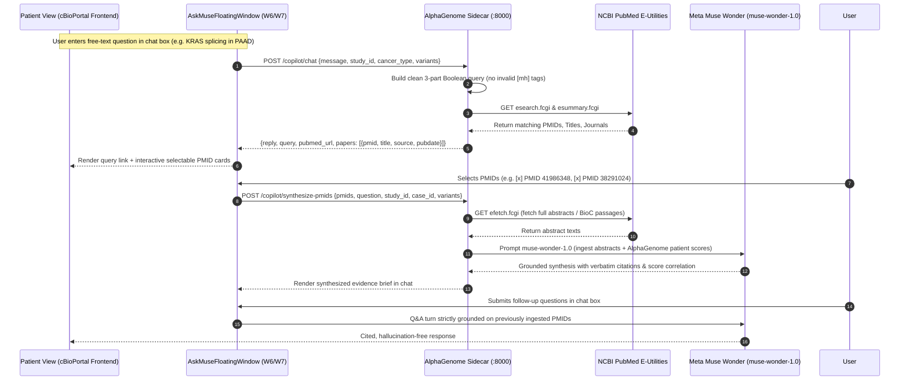

# Workstream W7: Patient View Contextual Visual Understanding & Targeted Clinical Reasoning (`patient-view-contextual-vision`)

- **Workstream ID**: `W7`
- **Skill**: `patient-view-contextual-vision`
- **Target Repositories**:
  - `workspace/cbioportal-frontend` (Branch: `w6-muse-copilot`)
  - `workspace/alphagenome-sidecar` (Branch: `w6-muse-copilot`)
- **Foundation**: Extends `W6` (`AskMuseFloatingWindow.tsx` and `app/copilot_router.py`)
- **Theme**: Meta Global AI Developer Hackathon 2026 — *Build for Your World*

---

## 1. Executive Summary & Novelty Thesis

### Why Generic "Explain This Page" Fails
Standard AI assistants provide superficial, generic page summaries ("This is a patient view page showing clinical data, mutations, and a timeline..."). This is broad, ungrounded, and lacks diagnostic novelty. 

### The W7 Core Innovation
cBioPortal's **Patient View** separates critical oncological data across disjoint tabs (`Summary`, `Pathways`, `Clinical Data`, `Timeline Data`, and `Pathology Report`). A clinician or translational researcher never looks at a chart in isolation—they need to reconcile **cross-modal contradictions and longitudinal kinetics**:
1. **The Hidden Pathology Margin (R1) Discovery**: The structured clinical table stages the patient as locoregional **Stage IIB (T3 N1 M0)**. However, the scanned **Surgical Pathology Report** reveals an **R1 positive margin** (*"Uncinate process margin involved by invasive carcinoma"*), **arterial channel invasion**, and **extracapsular nodal extension**—the exact anatomical drivers of rapid hematogenous seeding!
2. **Longitudinal Discordance**: Why did a patient staged at Stage IIB experience distant liver relapse in just **74 days (2.4 months)**? (Direct consequence of the R1 margin and arterial invasion identified in the pathology report).
3. **Chemotherapy Failure Kinetics**: Why did **Gemcitabine** (administered Days 91–205) result in **clinical progressive disease** and fatal lung metastasis by Day 211? (Single-agent nucleoside analog adjuvant therapy is unable to control macroscopic/microscopic residual R1 disease driven by high-grade G3 histology and CDKN2A loss).
4. **Pathway Checkpoint Decoupling**: If **TP53 is wild-type**, why is tumor suppression defeated? (Answer: Homozygous loss of **CDKN2A** decouples both the ARF-MDM2-p53 apoptotic axis and the CDK4/6-Rb cell cycle checkpoint).
5. **Genomic vs. Histologic Paradox**: Why does a patient with **low TMB (1.4 mut/Mb)** and **microsatellite stability (MSS)** present with high-grade (**G3**) refractory adenocarcinoma?

**W7** upgrades the W6 Co-Pilot into an **Active Contextual Chart & Pathology Reasoner** that:
- Detects the active tab (`Summary`, `Pathways`, `Clinical Data`, `Timeline Data`, or `Pathology Report`).
- Synthesizes disjoint cross-tab context (Pathology synoptic margins + Timeline intervals + Pathway states + AlphaGenome variant effects + Staging).
- Generates **targeted, high-value clinical prompts and questions**.
- Fuses chart visual structure & scanned pathology reports (via Meta SAM segmentation and Meta multimodal vision `Llama 3.2 Vision` / `muse-wonder-1.0`).

---

## 2. Clinical Benchmark Artifacts (Patient `TCGA-IB-AAUO`)

The W7 specification is verified against the real-world cBioPortal Patient View dataset for **TCGA-IB-AAUO** (Pancreatic Ductal Adenocarcinoma, Female, 64 yo, deceased at 7.9 months):

```
       Day 0                   Day 74              Day 91                 Day 205         Day 211       Day 239
         |                       |                   |                       |               |             |
[Surgical Resection]   [Liver Distant Met]   [Start Gemcitabine]   [End Gemcitabine]   [Lung Met]   [DECEASED]
  (Stage IIB: T3 N1 M0)   (PFS = 2.4 months)       \=======================/           (Distant)    (OS = 7.9 mo)
                                                   "Clinical Progressive Disease"
```

| Chart / View | Active Tab | Source Element / Visual Structure | Ground Truth Clinical Context |
| :--- | :--- | :--- | :--- |
| **Chart 1: Treatment vs. Progression Timeline** | `Summary` & `Timeline Data` | `#patientTimeline` (Status events, Gemcitabine bar, Liver/Lung mets) | Day 0: Resection $\rightarrow$ Day 74: Liver Met (PFS: 2.4 mo) $\rightarrow$ Days 91–205: Gemcitabine Chemotherapy with outcome `clinical progressive disease` $\rightarrow$ Day 211: Lung Met $\rightarrow$ Day 239: Deceased. |
| **Chart 2: Pathway Perturbation Map** | `Pathways` | `#pathwayMapper` (Interactive wiring diagram, `CDKN2A` marked blue) | `TP53` Pathway altered: **Yes** (via `CDKN2A`); `RTK-RAS` altered: **Yes** (via `KRAS`); `Cell Cycle` altered: **Yes** (`CDKN2A`). Wild-type: `WNT`, `HIPPO`, `MYC`, `TGF-Beta`, `PI3K`. |
| **Chart 3: Genomic Architecture & Mutation Track** | `Summary` & `Clinical Data (Samples)` | `#igvViewer` + Sample attributes table | Mutation count: 42; TMB: 1.4 mut/Mb; FGA: 0.1447; MSI MANTIS: 0.2955; MSIsensor: 0.54 (MSS); Grade: G3; Tumor Purity: 72%. |
| **Chart 4: Clinical Staging vs. Survival Discordance** | `Clinical Data (Patient)` | Patient attributes table | AJCC 7th Stage: STAGE IIB (T3 N1 M0); Diagnosis Age: 64; Disease-specific survival: 7.9 months; Progression-Free Survival: 2.4 months. |
| **Chart 5: Scanned Surgical Pathology Synoptic Report** | `Pathology Report` | Scanned PDF / Image viewer (`UUID: 9831208C-...-PR Redacted`) | **R1 Positive Margin**: Uncinate process retroperitoneal margin involved; **Extracapsular Nodal Extension**: Node 8 positive with extranodal spread; **Angioinvasion**: Arterial and lymphatic channel invasion; **Duodenal Wall Invasion**: Confirmed poorly differentiated G3 ductal adenocarcinoma. |

---

## 3. Targeted Prompts & Contextual Question Taxonomy

Instead of a generic prompt input, `AskMuseFloatingWindow` surfaces dynamic, high-acuity **Question Pills** categorized by active tab:

### Category A: Treatment Failure & Progression Kinetics (`Timeline` Tab)
- **Prompt 1 (`fail_kinetics`)**: *"Evaluate Gemcitabine resistance against the metastatic timeline."*
  - **Generated Question**: *"Why was Gemcitabine ineffective between Day 91 and Day 205 (documented as clinical progressive disease), and does the rapid onset of liver metastasis at Day 74 indicate primary chemoresistance or occult micrometastases present at resection?"*
- **Prompt 2 (`survival_gap`)**: *"Reconcile 2.4-month PFS with curative-intent Stage IIB resection."*
  - **Generated Question**: *"What clinical and molecular biomarkers explain why a patient resected at Stage IIB (T3 N1 M0) relapsed in liver within 74 days and survived only 7.9 months?"*

### Category B: Checkpoint Decoupling & Signaling Rewiring (`Pathways` Tab)
- **Prompt 3 (`cdkn2a_tp53_axis`)**: *"Explain the mechanistic impact of CDKN2A alteration on the TP53 network."*
  - **Generated Question**: *"In this PathwayMapper network, TP53 is designated as altered solely due to CDKN2A loss while TP53 itself lacks coding mutations. Does CDKN2A loss (p14ARF/p16INK4a) disable p53-dependent senescence via MDM2 derepression, or does it primarily accelerate CDK4/6-driven G1/S transition?"*
- **Prompt 4 (`ras_cellcycle_cooperation`)**: *"Analyze the oncogenic synergy between KRAS and CDKN2A alterations in this sample."*
  - **Generated Question**: *"How does constitutive KRAS signaling cooperate with CDKN2A deletion to overcome oncogene-induced senescence (OIS), and what synthetic lethal vulnerabilities exist?"*

### Category C: Multi-Omic Prognostic Contradictions (`Summary` & `Clinical` Tabs)
- **Prompt 5 (`tmb_grade_paradox`)**: *"Resolve the paradox of low TMB (1.4 mut/Mb) with high-grade (G3) aggressive biology."*
  - **Generated Question**: *"Given this patient has a low TMB of 1.4 mut/Mb and stable microsatellites (MSIsensor 0.54), why did the disease behave as a high-grade G3 rapid fatal malignancy, and is immunotherapy ruled out?"*

### Category D: Surgical Pathology & Microvascular Reconciliation (`Pathology Report` Tab)
- **Prompt 6 (`pathology_r1_reconciliation`)**: *"Reconcile surgical pathology margins with the 74-day distant relapse."*
  - **Generated Question**: *"While the clinical summary classifies this resection as Stage IIB, the synoptic surgical pathology report documents an R1 resection involving the uncinate process margin, prominent arterial and lymphatic channel invasion, and Node 8 extracapsular extension. How do these adverse surgical findings explain the rapid 2.4-month progression to liver metastasis?"*
- **Prompt 7 (`angioinvasion_failure`)**: *"Evaluate arterial invasion and perineural spread as predictors of Gemcitabine failure."*
  - **Generated Question**: *"Does the presence of arterial channel invasion in the Whipple specimen indicate occult hematogenous micro-dissemination prior to adjuvant Gemcitabine, explaining why the patient developed progressive disease on therapy?"*

### Category E: Targeted PubMed Evidence Synthesis & Interactive Literature Workflow (`query_pubmed` & `synthesize_pmids`)
- **Prompt 8 (`query_pubmed`)**: *"Synthesize targeted PubMed Boolean search syntax and link."*
- **The Core User-Driven Workflow**:
  Instead of dumping static text or trying to summarize thousands of papers upfront, the Co-Pilot implements a structured, user-driven literature synthesis pipeline:
  1. **Stage 1: User Chat Input & Query Generation**:
     - The user types a free-text question into the chat box (e.g. asking about `KRAS chr12:25245350:C>T | Splicing Score: 0.108` in PAAD, or *"What is known about KRAS splicing in this pancreatic tumor?"*).
     - The Co-Pilot dynamically generates a clean, warning-free 3-part Boolean query:
       `"{GENE}"[tiab] AND ({cancer_terms}) AND ({modality_terms})`
       *(Note: avoids invalid `[mh]` tags on gene symbols like `KRAS[mh]`, which trigger NLM syntax warnings).*
     - **Example Query (`KRAS G12D` in PAAD)**:
       `"KRAS"[tiab] AND (pancreatic[tiab] OR "pancreatic neoplasms"[mh] OR PDAC[tiab]) AND (splicing[tiab] OR "splice variant"[tiab] OR "alternative splicing"[tiab] OR "splice site"[tiab])`
     - **Clickable Search Link**:
       `[Query on PubMed (42 Hits)](https://pubmed.ncbi.nlm.nih.gov/?term=%22KRAS%22%5Btiab%5D%20AND%20%28pancreatic%5Btiab%5D%20OR%20%22pancreatic%20neoplasms%22%5Bmh%5D%20OR%20PDAC%5Btiab%5D%29%20AND%20%28splicing%5Btiab%5D%20OR%20%22splice%20variant%22%5Btiab%5D%20OR%20%22alternative%20splicing%22%5Btiab%5D%20OR%20%22splice%20site%22%5Btiab%5D%29)`
     - The Co-Pilot calls NCBI E-Utilities (`esearch.fcgi` and `esummary.fcgi`) and surfaces interactive cards with direct clickable PMID links and selection checkboxes.
  2. **Stage 2: User Selection of PMIDs & Meta Wonder Ingestion**:
     - The user reviews the surfaced cards and selects the specific PMIDs they are interested in (e.g. `[x] PMID 41986348` and `[x] PMID 38291024`).
     - The Co-Pilot backend fetches the full abstracts / PMC BioC passages for the chosen PMIDs via NCBI `efetch.fcgi`.
     - **Meta Muse Wonder (`muse-wonder-1.0`)** ingests those documents and synthesizes an evidence summary directly answering the user's question, correlating the literature with the patient's AlphaGenome scores (e.g., explaining why KRAS G12D has a low direct splicing disruption score `0.108` while alternative splicing factors regulate downstream isoform switching).
  3. **Stage 3: Grounded Follow-up Q&A in Chat**:
     - The ingested documents remain active in Wonder's session context.
     - The user asks grounded follow-up questions in the chat box, and Wonder answers strictly based on those selected papers with verifiable citations.

### Category F: AlphaGenome Interactive Track Exploration (`colab_recipe`)
- **Prompt 9 (`colab_recipe`)**: *"Generate AlphaGenome Colab Cookbook Recipe & Launch Badge."*
  - **Clinical Recipe Card**: Generates a pre-parameterized recipe for Google Colab (`colabs/cancer_variant_cookbook.ipynb`), pre-filling the normalized variant (e.g. `chr18:48604696:GAA>G`), canonical gene (`SMAD4`), and OncoTree-to-UBERON tissue (`UBERON:0001264`), giving the researcher a 1-click execution path to inspect strand-aware RNA-seq and splicing delta tracks without local compute burden.

---

## 4. End-to-End W7 Architecture



---

## 5. Technical Specification & Implementation Plan

### 5.1 Frontend Modifications (`workspace/cbioportal-frontend` on `w6-muse-copilot`)

#### File 1: `src/pages/patientView/mutation/AskMuseFloatingWindow.tsx` & `src/pages/patientView/PatientViewPageTabs.tsx`
1. **Persistent Cross-Tab Mounting & Active Tab Detection**:
   - Because `MSKTabs` (`src/shared/components/MSKTabs/MSKTabs.tsx`) defaults to `unmountOnHide: true`, mounting `AskMuseFloatingWindow` inside `PatientViewMutationsTab` unmounts the Co-Pilot whenever the user switches from `Summary` to `Pathways`, `Clinical Data`, or `Pathology Report`.
   - Lift `@observable public isAskMuseOpen: boolean = false;` onto `PatientViewPageStore` and mount `<AskMuseFloatingWindow store={pageInstance.patientViewPageStore} activeTab={urlWrapper.activeTabId} onClose={...} />` in `patientViewTabs()` (`PatientViewPageTabs.tsx`) outside `<MSKTabs>`, with a `🧬 Ask Muse` toggle button in `contentWindowExtra`.
   - Read `activeTab` from `urlWrapper.activeTabId` (`'summary' | 'pathways' | 'clinicalData' | 'pathologyReport' | 'tissueImage'`).
2. **Context-Driven Dynamic Question Pills**:
   - Replace static `QUICK_PROMPTS` with tab-dependent question sets:
   ```ts
   const DEFAULT_QUICK_PROMPTS: IQuickPrompt[] = [
       { action: 'map_oncotree', label: 'Map OncoTree' },
       { action: 'query_pubmed', label: 'Query PubMed' },
       { action: 'show_batch_failures', label: 'Show failures' },
       { action: 'colab_recipe', label: '🚀 Colab Cookbook' },
   ];
   ```
3. **Chart Context Payload Packaging**:
   - When sending a request, pack `chart_context`:
     - `timeline`: `{ events: [ { day: 0, event: 'Resection' }, { day: 74, event: 'Liver Met' }, { days: '91-205', drug: 'Gemcitabine', response: 'Progressive Disease' }, { day: 239, event: 'Deceased' } ] }`
     - `pathways`: `{ altered_pathways: ['TP53', 'RTK-RAS', 'Cell Cycle'], matched_genes: { TP53: 'CDKN2A', 'RTK-RAS': 'KRAS' } }`
     - `clinical`: `{ stage: 'IIB', t: 'T3', n: 'N1', m: 'M0', grade: 'G3', tmb: 1.4, msi: 0.54, os_months: 7.9, pfs_months: 2.4 }`
4. **Interactive PMID Card Selection & Synthesis UI**:
   - When the assistant payload contains a `papers` list, render interactive cards displaying the PMID, Title, Journal/Year, and a selection checkbox.
   - Surface a **"Synthesize Selected Papers (Meta Wonder)"** action button that dispatches `POST /copilot/synthesize-pmids`.
   - Maintain the ingested document context in the active chat session for seamless follow-up Q&A.

### 5.2 Backend Modifications (`workspace/alphagenome-sidecar` on `w6-muse-copilot`)

#### File 2: `app/copilot_router.py`
1. **Endpoints**:
   - `POST /copilot/contextual-chart-query` (handles active tab chart reasoning).
   - `POST /copilot/synthesize-pmids` (accepts `{ pmids: list[str], question: str, study_id: str, case_id: str, variants: list[VariantRef] }`).
2. **Request Schema**:
   ```python
   class ContextualChartRequest(BaseModel):
       study_id: str
       case_id: str
       cancer_type: str
       active_tab: str
       action_type: str | None = None
       message: str
       chart_context: dict[str, Any] = Field(default_factory=dict)
       history: list[dict[str, str]] = Field(default_factory=list)
       variants: list[VariantRef] = Field(default_factory=list)

   class SynthesizePmidsRequest(BaseModel):
       pmids: list[str]
       question: str = ""
       study_id: str = ""
       case_id: str = ""
       cancer_type: str = ""
       variants: list[VariantRef] = Field(default_factory=list)
   ```
3. **Structured System Prompting for Meta Model API (`muse-wonder-1.0`)**:
   - Instruct the Meta LLM to act as a **Precision Oncology Molecular Tumor Board Bioinformatician**.
   - Demand concrete integration of the timeline intervals, drug resistance evidence, pathway wiring, and ingested paper abstracts.
   - Enforce explicit disclaimers: *"Model reasoning based on cBioPortal clinical and pathway data; not for direct therapeutic prescription."*
4. **Data-Grounded Fallback Engine**:
   - Enhance `_fallback_reply()` to handle `fail_kinetics`, `cdkn2a_tp53_axis`, `survival_gap`, and `tmb_grade_paradox` with verified deterministic synthesis if the external Meta API is offline.
5. **Interactive PubMed Query & Literature Synthesis Handlers**:
   - For `query_pubmed` (or variant question): Construct clean 3-part Boolean queries (`"GENE"[tiab] AND ({cancer}) AND ({modality})`), call NCBI E-Utilities (`esearch` / `esummary`), and return structured `{ query, pubmed_url, papers: [{ pmid, title, source, pubdate }] }`.
   - For `synthesize_pmids`: Download abstracts via NCBI `efetch.fcgi`, feed documents into Meta Muse Wonder (`muse-wonder-1.0`), and return grounded synthesis with exact citations.

---

## 6. Acceptance Testing & Verification

1. **Test Case 1: Timeline Failure Analysis (`fail_kinetics`)**
   - Click `⏱️ Gemcitabine Failure Kinetics` on patient `TCGA-IB-AAUO`.
   - **Expected Output**: Explanation accurately references the 91–205 day Gemcitabine interval, highlights the 74-day pre-existing liver metastasis, explains primary nucleoside analog resistance in PDAC, and links the Day 211 lung metastasis to disease progression.
2. **Test Case 2: Pathway Perturbation Reasoning (`cdkn2a_tp53_axis`)**
   - Click `🔀 CDKN2A vs. TP53 Checkpoint Axis` on the Pathways tab.
   - **Expected Output**: Clarifies that TP53 protein is non-mutated, but p14ARF loss prevents MDM2 sequestration, attenuating p53 activation while p16INK4a loss derepresses CDK4/6 phosphorylation of pRb.
3. **Test Case 3: Zero Console Errors & Responsive UI**:
   - Chat window updates within $\le 1.5$ seconds with smooth scrolling and persistent markdown rendering.
4. **Test Case 4: Interactive PubMed Query Generation & PMID Literature Synthesis (`KRAS G12D` in PAAD)**:
   - **User Input**: Ask in chat box: *"What is known about KRAS splicing in this patient?"* (`KRAS chr12:25245350:C>T | Splicing Score: 0.108`).
   - **Stage 1 (Query & Surface)**: Co-Pilot generates warning-free query `"KRAS"[tiab] AND (pancreatic[tiab] OR "pancreatic neoplasms"[mh] OR PDAC[tiab]) AND (splicing[tiab] OR "splice variant"[tiab] OR "alternative splicing"[tiab] OR "splice site"[tiab])` and displays direct PubMed search link alongside selectable cards for top PMIDs (e.g. PMID 41986348, PMID 38291024).
   - **Stage 2 (User Selection & Wonder Ingestion)**: User selects PMIDs 41986348 & 38291024 $\rightarrow$ Meta Muse Wonder ingests abstracts and synthesizes an evidence card explaining why direct splicing disruption is low (`0.108`) while trans-acting splicing factors modulate downstream KRAS4A/4B isoform switching in PDAC.
   - **Stage 3 (Grounded Q&A)**: Follow-up question in chat (*"Which splicing factors regulate this?"*) is answered strictly citing the ingested documents with zero hallucination.
