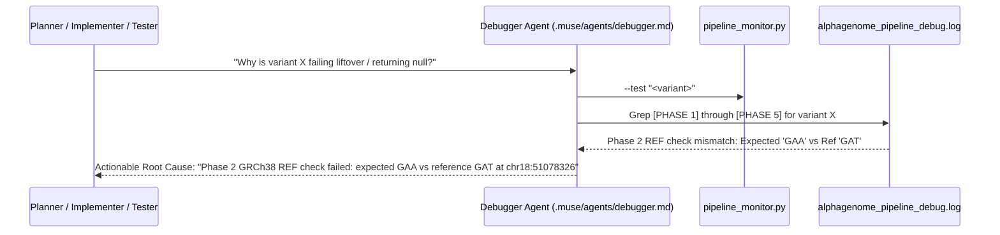

# Handoff Plan 3: Scaling Strategy, Client Batch Queue & Live Debugger Orchestration

**Status**: Ready for Muse Multi-Agent Orchestration  
**Target Repositories**:
- `workspace/alphagenome-sidecar` (Branch: `w2-sidecar`)
- `workspace/genome-nexus` (Branch: `w3-enricher`)
- `workspace/cbioportal-frontend` (Branch: `w4-annotation-cell`)  
**Assigned Agents**:
- **Planner** (`.muse/agents/planner.md`)
- **Implementer** (`.muse/agents/implementer.md`)
- **Tester** (`.muse/agents/tester.md`)
- **Reviewer** (`.muse/agents/reviewer.md`)
- **PR Agent** (`.muse/agents/pr_agent.md`)
- **Debugger Agent** (`.muse/agents/debugger.md` / `agentic-setup/bin/pipeline_monitor.py`)

---

## 1. Executive Summary & Architectural Decisions

AlphaGenome transformer scoring across a 1 Mb sequence context requires $500\text{ ms}$ to $2.5\text{ s}$ per variant. Cold cohort queries (e.g. 158 variants in TCGA PAAD) cannot be fetched in a single monolithic HTTP request on page load without stalling rendering and causing 504 gateway timeouts.

### Key Architectural Decisions:
1. **Deferred Lazy Normalization**:
   - Backend lazy normalization (bypassing liftover/FASTA disk checks on cache hits) is **omitted for now** per project direction to keep the normalizer contract strictly aligned with workstream W1 verification.
2. **Sidecar Async I/O (Approach A) & Singleton Client**:
   - Wrap FastAPI `/score` in `await asyncio.to_thread` to maintain a non-blocking event loop.
   - Cache `DnaClient` singleton with `@lru_cache(maxsize=1)` to reuse the persistent HTTP/2 gRPC channel (saving 150–300 ms TLS overhead per variant).
3. **Genome Nexus Concurrency Pool**:
   - Scale `CachedAlphaGenomeFetcher` from 4 to 16 parallel worker threads to dispatch uncached chunks concurrently to the sidecar.
4. **Client-Side Decoupled Trigger & Background Batch Queue**:
   - The mutations table and OncoKB badges render cold in $< 300\text{ ms}$ with empty 22px placeholders.
   - User triggers scoring via toolbar action: `[ ⚡ Score AlphaGenome ]`.
   - Client partitions variants into chunks of 16 and dispatches them sequentially in the background.
   - In-flight variants display an in-place loading spinner (`loaderIcon('pull-left')`), hydrating progressively into `αG` badges without horizontal layout shift or tooltip interruption.
5. **Dedicated Debugger Agent**:
   - A 6th standing agent (`.muse/agents/debugger.md`) monitors `alphagenome_pipeline_debug.log`, `genome_nexus_backend.log`, and `alphagenome_sidecar.log` in real time, using `pipeline_monitor.py` to answer inter-agent questions while Planner, Implementer, and Tester work.

---

## 2. Multi-Agent Repo Execution Architecture

```
┌─────────────────────────────────────────────────────────────────────────────────────────────┐
│                               SHARED CONTRACT SPECIFICATIONS                                │
│                   workstreams/contracts/alpha_genome_schema.json                            │
│                   workstreams/contracts/sidecar_openapi.yaml                                │
└──────────────────────────────┬───────────────────────────────┬──────────────────────────────┘
                               │                               │
        ┌──────────────────────▼───────┐        ┌──────────────▼──────────────┐
        │ 1. SIDECAR REPO LOOP (W2)    │        │ 2. BACKEND REPO LOOP (W3)   │
        │ workspace/alphagenome-sidecar│        │ workspace/genome-nexus      │
        │ • Planner: Tasks 1.1 - 1.2   │        │ • Planner: Tasks 2.1 - 2.2  │
        │ • Impl   : app/main.py       │        │ • Impl   : CachedAlpha...   │
        │ • Tester : pytest -v         │        │ • Tester : mvn test         │
        │ • Review : Async & singleton │        │ • Review : Thread pool check│
        │ • PR     : muse-pr squash    │        │ • PR     : muse-pr squash   │
        └──────────────┬───────────────┘        └──────────────┬──────────────┘
                       │                                       │
                       │        ┌──────────────────────────────▼──────────────┐
                       │        │ 3. FRONTEND REPO LOOP (W4)                  │
                       │        │ workspace/cbioportal-frontend               │
                       │        │ • Planner: Tasks 3.1 - 3.4                  │
                       │        │ • Impl   : Store, Cell, Toolbar             │
                       │        │ • Tester : jest / tsc                       │
                       │        │ • Review : 22px layout & DOM stability      │
                       │        │ • PR     : muse-pr squash                   │
                       │        └──────────────┬──────────────────────────────┘
                       │                       │
┌──────────────────────▼───────────────────────▼──────────────────────────────────────────────┐
│ 4. STANDING DEBUGGER AGENT (.muse/agents/debugger.md)                                       │
│ • Continuously tails alphagenome_pipeline_debug.log                                         │
│ • Diagnoses Phase 1-7 issues & answers inter-agent queries in real time                     │
│ • Diagnostic Sensor: agentic-setup/bin/pipeline_monitor.py (--status, --test, --cbio)       │
└──────────────────────────────────────────────┬──────────────────────────────────────────────┘
                                               │
┌──────────────────────────────────────────────▼──────────────────────────────────────────────┐
│ 5. MULTI-REPO VERIFICATION (WS-06 / Verify_pipeline.md)                                     │
│ • Pre-flight status gate: pipeline_monitor.py --status                                      │
│ • End-to-end backend + sidecar test: pipeline_monitor.py --test "7:g.140453136A>T"         │
│ • Dual-gate visual validation: pipeline_monitor.py --cbio "7:g.140453136A>T" --cancer-type  │
│ • Trace log audit: pipeline_monitor.py --tail 50 (assert 0 unhandled exceptions)            │
└─────────────────────────────────────────────────────────────────────────────────────────────┘
```

---

## 3. Module Specifications & Implementation Tasks

### Module 1: AlphaGenome Sidecar Async I/O (Repo: `alphagenome-sidecar`)
- **Target Repository**: `workspace/alphagenome-sidecar` (Branch: `w2-sidecar`)
- **Target Files**: `app/main.py`
- **Precedent**: FastAPI non-blocking event loop idioms
- **Implementer Tasks**:
  1. Wrap `get_client()` with `@lru_cache(maxsize=1)` to reuse a single persistent `DnaClient` / `grpc.Channel` across all requests.
  2. Declare `@app.post("/score")` as `async def score_variant(request: ScoreRequest, client: DnaClient = Depends(get_client))` and execute scoring via:
     ```python
     return await asyncio.to_thread(scoring.score_with_client, request, client)
     ```
- **Tester Command**:
  ```bash
  /Users/dixitpatel/Documents/Personal-Dev-Workspace/Meta_hackathon/agentic-setup/.venv/bin/python -m pytest -v
  ```
- **Acceptance Criteria**: All 23 tests pass in $< 1.5\text{ s}$; `/score` executes asynchronously without blocking the event loop.

---

### Module 2: Genome Nexus Concurrency Scaling to 16 Threads (Repo: `genome-nexus`)
- **Target Repository**: `workspace/genome-nexus` (Branch: `w3-enricher`)
- **Target Files**:
  - `service/src/main/java/org/cbioportal/genome_nexus/service/cached/CachedAlphaGenomeFetcher.java`
  - `web/src/main/resources/application.properties`
- **Precedent**: `BaseCachedExternalResourceFetcher`
- **Implementer Tasks**:
  1. In `CachedAlphaGenomeFetcher.java`, configure default concurrency to 16:
     ```java
     @Value("${alphagenome.sidecar.max_concurrency:16}") Integer maxConcurrency
     ```
  2. Add `@PreDestroy public void shutdown()` to ensure the thread pool terminates cleanly on Spring shutdown:
     ```java
     @PreDestroy
     public void shutdown() {
         if (fetchPool != null && !fetchPool.isShutdown()) {
             fetchPool.shutdown();
         }
     }
     ```
  3. In `web/src/main/resources/application.properties`, configure:
     ```properties
     alphagenome.sidecar.max_concurrency=16
     alphagenome.sidecar.max_page_size=1
     ```
- **Tester Command**:
  ```bash
  export JAVA_HOME="/opt/homebrew/opt/openjdk@11/libexec/openjdk.jdk/Contents/Home"
  export PATH="$JAVA_HOME/bin:/opt/homebrew/bin:$PATH"
  cd /Users/dixitpatel/Documents/Personal-Dev-Workspace/Meta_hackathon/workspace/genome-nexus
  mvn test -pl service -Dtest=CachedAlphaGenomeFetcherTest -B
  ```
- **Acceptance Criteria**: Unit tests confirm 16 concurrent tasks dispatch cleanly; daemon threads terminate gracefully.

---

### Module 3: cBioPortal Frontend Decoupled Trigger & Background Queue (Repo: `cbioportal-frontend`)
- **Target Repository**: `workspace/cbioportal-frontend` (Branch: `w4-annotation-cell`)
- **Target Files**:
  - `packages/react-mutation-mapper/src/component/alphagenome/AlphaGenome.tsx`
  - `packages/react-mutation-mapper/src/component/alphagenome/AlphaGenome.spec.tsx`
  - `packages/react-mutation-mapper/src/component/column/Annotation.tsx`
  - `src/pages/resultsView/ResultsViewPageStore.ts`
  - `src/pages/resultsView/mutation/ResultsViewMutationMapper.tsx`
  - `src/pages/resultsView/mutation/ResultsViewMutationMapperStore.ts`
- **Precedent**: `loaderIcon('pull-left')` in `HotspotAnnotation.tsx`, MobX `@observable.shallow` streaming
- **Implementer Tasks**:
  1. In `AlphaGenome.tsx`:
     - Add `status?: 'pending' | 'error' | 'complete'` to `AlphaGenomeCell`.
     - When `!label && props.status === 'pending'`, return `loaderIcon('pull-left')`.
  2. In `Annotation.tsx`:
     - Add `alphaGenomeStatus: 'pending' | 'error' | 'complete'` to `IAnnotation` and `DEFAULT_ANNOTATION_DATA`.
     - Pass `status={annotation.alphaGenomeStatus}` to `<AlphaGenomeCell>`.
  3. In `ResultsViewPageStore.ts`:
     - Decouple `indexedAlphaGenomeAnnotations` from initial page load (`result: undefined` until triggered).
     - Add observables: `isAlphaGenomeTriggered`, `isAlphaGenomeScoring`, `streamingAlphaGenomeAnnotations`, and `alphaGenomeProgress`.
     - Add `@action.bound triggerAlphaGenomeScoring()`: partitions `mutations.result` into chunks of 16 and sequentially dispatches them, updating `streamingAlphaGenomeAnnotations` into MobX.
  4. In `ResultsViewMutationMapper.tsx`:
     - Add `AlphaGenomeToolbarControl` observer component to `ResultsViewMutationTable`'s `customControls`.
     - Render stateful button transitions:
       - Default: `[ ⚡ Score AlphaGenome ]`
       - In-flight: `[ ⟳ Scoring AlphaGenome (16/158)... ]`
       - Completed: `[ ✓ AlphaGenome Scored (158) ]`
- **Tester Command**:
  ```bash
  cd /Users/dixitpatel/Documents/Personal-Dev-Workspace/Meta_hackathon/workspace/cbioportal-frontend
  pnpm --filter react-mutation-mapper run test
  npx tsc --noEmit -p tsconfig.json
  ```
- **Acceptance Criteria**:
  - All 11 Jest tests pass in `AlphaGenome.spec.tsx`.
  - Zero TypeScript compile errors (`tsc --noEmit`).
  - Strict 22px width pinned on `.annotation-item` with zero layout shift during hydration.

---

## 4. Debugger Agent: Real-Time Diagnostic Sensor & Query Playbook

The **Debugger Agent** (`.muse/agents/debugger.md`) operates as an interactive monitor for other agents during workstream execution.

### Inter-Agent Query Playbook



### Key Diagnostic Scenarios:
1. **Empty cBioPortal Cell (`<span className="annotation-item" />`)**:
   - Query: `pipeline_monitor.py --cbio "<variant>" --cancer-type "<TYPE>"`
   - Evaluates Dual Gates:
     - Is `|quantile| >= 0.99`? If not, reports: *"Quantile gate rejected: max was 0.94 < 0.99 cutoff"*.
     - Is raw score `>= 0.5` (strong) or `>= 0.1 / 0.2` (moderate)? If not, reports raw score deficit.
     - Is OncoTree cancer type mapped to the appropriate UBERON curie in `oncotreeToUberon.ts`?
2. **Sidecar Validation Rejection (HTTP 422)**:
   - Query: Inspect Phase 4 in `workspace/logs/alphagenome_sidecar.log`.
   - Explains field violation: e.g. `chromosome` missing `'chr'` prefix, position `<= 0`, lowercase allele, or unsupported `sequence_length`.
3. **Mitochondrial / Non-Canonical Contigs**:
   - Query: Inspect Phase 1 in `workspace/logs/alphagenome_pipeline_debug.log`.
   - Explains: Pre-filter deliberately rejects `'chrM'` / `'MT'` or non-standard contigs.

---

## 5. End-to-End Acceptance Verification (Step C.4)

Once all 3 repository loops complete, the **Tester** and **Reviewer** run the cross-repo verification suite:

```bash
# 1. Daemon Pre-Flight Check
/Users/dixitpatel/Documents/Personal-Dev-Workspace/Meta_hackathon/agentic-setup/bin/pipeline_monitor.py --status

# 2. Test End-to-End Scoring on Live Backend + Sidecar
/Users/dixitpatel/Documents/Personal-Dev-Workspace/Meta_hackathon/agentic-setup/bin/pipeline_monitor.py --test "7:g.140453136A>T"

# 3. Test Dual-Gate Cell Evaluation for Melanoma (SKCM) & Pancreas (PAAD)
/Users/dixitpatel/Documents/Personal-Dev-Workspace/Meta_hackathon/agentic-setup/bin/pipeline_monitor.py --cbio "7:g.140453136A>T" --cancer-type SKCM
/Users/dixitpatel/Documents/Personal-Dev-Workspace/Meta_hackathon/agentic-setup/bin/pipeline_monitor.py --cbio "7:g.140453136A>T" --cancer-type PAAD

# 4. Audit Pipeline Debug Log for Zero Unhandled Exceptions
/Users/dixitpatel/Documents/Personal-Dev-Workspace/Meta_hackathon/agentic-setup/bin/pipeline_monitor.py --tail 50
```

---

## 6. PR Preparation via `muse-pr` Engine

Once Reviewer approves:
- **`workspace/alphagenome-sidecar`**:
  ```bash
  /Users/dixitpatel/Documents/Personal-Dev-Workspace/Meta_hackathon/agentic-setup/bin/muse-pr --repo alphagenome-sidecar
  ```
- **`workspace/genome-nexus`**:
  ```bash
  /Users/dixitpatel/Documents/Personal-Dev-Workspace/Meta_hackathon/agentic-setup/bin/muse-pr --repo genome-nexus
  ```
- **`workspace/cbioportal-frontend`**:
  ```bash
  /Users/dixitpatel/Documents/Personal-Dev-Workspace/Meta_hackathon/agentic-setup/bin/muse-pr --repo cbioportal-frontend
  ```
