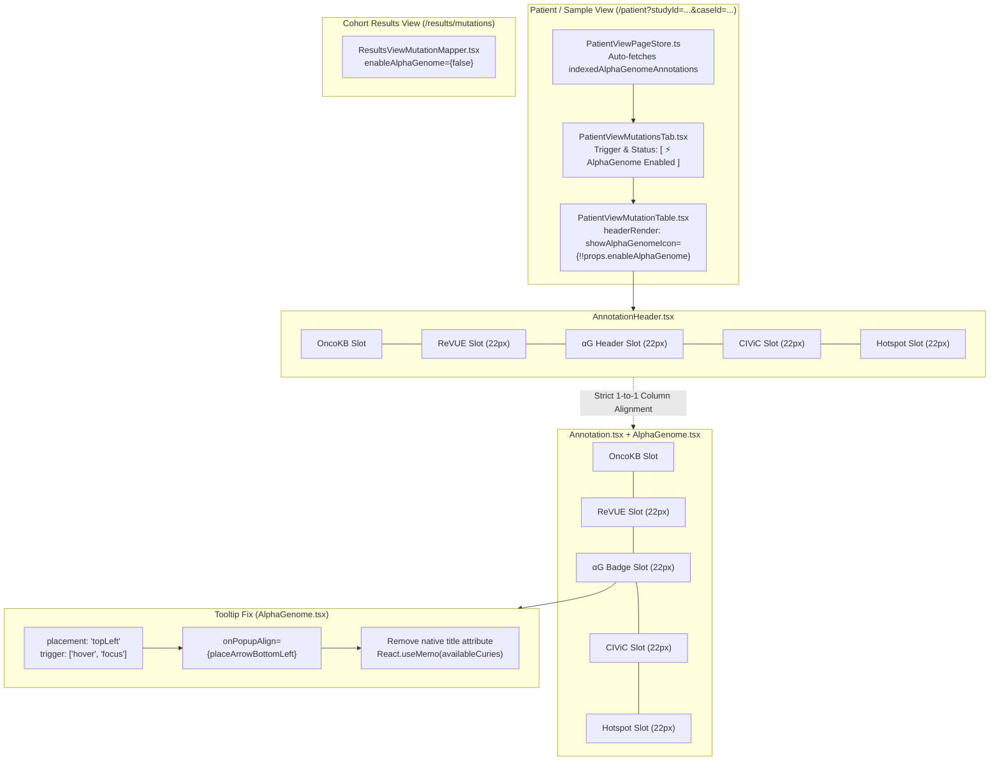

# Handoff Plan 4: AlphaGenome UI Alignment, Tooltip Fix & Sample-First Integration

**Workstream ID**: `WS-08` / `Task-Sample-First-UI-Refinement`  
**Status**: Ready for Muse Multi-Agent Orchestration  
**Target Repository**: `workspace/cbioportal-frontend` (Branch: `w4-annotation-cell`)  
**Design Approach**: **Option A (Sample-First Focus)** — Focus AlphaGenome predictions and UI elements strictly on the Patient / Sample View where single-patient variant interpretation is most clinically actionable.  
**Assigned Agents**:
- **Planner** (`.muse/agents/planner.md`)
- **Implementer** (`.muse/agents/implementer.md`)
- **Tester** (`.muse/agents/tester.md`)
- **Reviewer** (`.muse/agents/reviewer.md`)
- **Verifier** (`.muse/agents/verifier.md` / `muse-verify`)
- **PR Agent** (`.muse/agents/pr_agent.md` / `muse-pr`)

---

## 1. Executive Summary & Problem Scope

### Scope Adjustments (User Directives)
1. **Sample-First Focus (Option A)**:
   - Enable AlphaGenome predictions **by default on the Patient / Sample View** (`/patient?studyId=...&caseId=...`).
   - Move/place the AlphaGenome trigger and status indicator directly next to the **Sample View mutation table**.
   - Disable AlphaGenome on the Cohort Results View (`enableAlphaGenome={false}` in `ResultsViewMutationMapper.tsx`) to avoid cohort-scale bottlenecks and focus functional interpretation exclusively where it matters.
2. **Defect 3 (Splicing Threshold) Deferred**:
   - Defect 3 (splicing threshold tuning 0.20 vs 0.10) is deferred for future biological consensus. **Do not modify threshold code in this workstream.**
3. **Pure UI Polish**:
   - Strictly resolve:
     - **Header vs. row icon misalignment** in the Patient / Sample View.
     - **Hover tooltip mounting** and native OS tooltip conflict on the `αG` badge.
     - **Standardized 22px fixed slot grid alignment** between `AnnotationHeader.tsx` and `AlphaGenome.tsx`.

---

## 2. Root Cause Analysis

### Defect A: Header vs. Row Icon Misalignment in Patient / Sample View
- **File**: `src/pages/patientView/mutation/PatientViewMutationTable.tsx` (lines 323–337)
- **Root Cause**:
  `PatientViewMutationTable` overrides `this._columns[MutationTableColumnType.ANNOTATION].headerRender`:
  ```tsx
  // CURRENT DEFECTIVE CODE in PatientViewMutationTable.tsx:
  this._columns[MutationTableColumnType.ANNOTATION].headerRender = (name: string) => {
      return (
          <AnnotationHeader
              name={name}
              width={this.oncokbWidth}
              mergeOncoKbIcons={this.props.mergeOncoKbIcons}
              onOncoKbIconToggle={this.handleOncoKbIconModeToggle}
              showRevueIcon={this.props.enableRevue && this.shouldShowRevue}
              // BUG: showAlphaGenomeIcon was completely omitted!
          />
      );
  };
  ```
- **Visual Failure**:
  - The **header** rendered only **3 icons** (`OncoKB`, `CIViC`, `Cancer Hotspots`).
  - The **rows** rendered **4 icons** (`OncoKB`, **`αG` badge**, `CIViC`, `Cancer Hotspots`).
  - This 1-slot disparity shifted every annotation icon in the rows by 22px to the right: the orange `αG` badge sat under `CIViC`, `CIViC` sat under `Hotspots`, and `Hotspots` hung out past the header.
- **Header Slot Geometry**: In `AnnotationHeader.tsx`, `αG` used manual margins (`marginLeft: 7, marginRight: 1`) rather than a strict 22px centered inline-flex slot (`width: 22, height: 18, display: 'inline-flex', justifyContent: 'center', alignItems: 'center'`).

### Defect B: Tooltip Hover Failure on `αG` Badge
- **File**: `packages/react-mutation-mapper/src/component/alphagenome/AlphaGenome.tsx`
- **Root Causes**:
  1. `AlphaGenomeCell` used `placement="bottom"` without `onPopupAlign={placeArrowBottomLeft}`. In `DefaultTooltip.tsx`, center-aligned placements call jQuery `$(targetEl).offset().left`, throwing an unhandled `TypeError` inside React 18 table cell nodes. Hotspot annotations avoided this bug by configuring `placement="topLeft"` and `onPopupAlign={placeArrowBottomLeft}`.
  2. The badge's inner `<span>` included a native HTML `title={`AlphaGenome: ${label}`}` attribute. When hovering over the cell, the browser fires native OS tooltips that collide with and suppress `rc-tooltip` mouseenter events.
  3. In `AlphaGenomeTooltipContent`, `availableCuries(rows)` was called synchronously on every render and mouse event without memoization, rescanning up to 5,144 tracks per hover.

---

## 3. Architecture: Sample-First Focus Model



---

## 4. Atomic Tasks for Muse Multi-Agent Implementation

### Task 1: Fix `DefaultTooltip` Mounting & Native `title` Conflict
- **Files**:
  - `packages/react-mutation-mapper/src/component/alphagenome/AlphaGenome.tsx`
  - `packages/react-mutation-mapper/src/component/column/Annotation.tsx`
- **Actions**:
  1. In `AlphaGenome.tsx`:
     - Import `placeArrowBottomLeft` from `cbioportal-frontend-commons`:
       ```tsx
       import { DefaultTooltip, placeArrowBottomLeft } from 'cbioportal-frontend-commons';
       ```
     - Update `DefaultTooltip` props in `AlphaGenomeCell`:
       ```tsx
       <DefaultTooltip
           placement="topLeft"
           trigger={['hover', 'focus']}
           onPopupAlign={placeArrowBottomLeft}
           overlay={
               <AlphaGenomeTooltipContent
                   annotation={props.annotation!}
                   cancerType={props.cancerType}
                   ontologyCurie={displayCurie}
               />
           }
       >
           <span
               className={`${annotationStyles['annotation-item']}`}
               style={{
                   width: 22,
                   height: 18,
                   display: 'inline-flex',
                   alignItems: 'center',
                   justifyContent: 'center',
                   cursor: 'pointer',
               }}
           >
               <span
                   style={{
                       fontSize: 10,
                       fontWeight: 700,
                       lineHeight: '14px',
                       color: label === 'strong' ? '#d7301f' : '#fd8d3c',
                   }}
               >
                   αG
               </span>
           </span>
       </DefaultTooltip>
       ```
     - Remove `title={`AlphaGenome: ${label}`}` from the inner `<span>` to prevent browser tooltip collisions.
     - Memoize `availableCuries`:
       ```tsx
       const curies = React.useMemo(() => availableCuries(rows), [rows]);
       ```
  2. In `Annotation.tsx`:
     - Make `alphaGenomeStatus` optional in `IAnnotation` interface (`alphaGenomeStatus?: AlphaGenomeCellStatus;`) so other tables (such as copy number alterations or structural variants) do not throw TS2741.

---

### Task 2: Pass `showAlphaGenomeIcon` in `PatientViewMutationTable.tsx`
- **File**: `src/pages/patientView/mutation/PatientViewMutationTable.tsx`
- **Actions**:
  1. In line 323–337, update `headerRender` for the `ANNOTATION` column to pass `showAlphaGenomeIcon`:
     ```tsx
     this._columns[MutationTableColumnType.ANNOTATION].headerRender = (
         name: string
     ) => {
         return (
             <AnnotationHeader
                 name={name}
                 width={this.oncokbWidth}
                 mergeOncoKbIcons={this.props.mergeOncoKbIcons}
                 onOncoKbIconToggle={this.handleOncoKbIconModeToggle}
                 showRevueIcon={
                     this.props.enableRevue && this.shouldShowRevue
                 }
                 showAlphaGenomeIcon={!!this.props.enableAlphaGenome}
             />
         );
     };
     ```
  2. This restores the `αG` column header slot in the Patient / Sample View, restoring exact 1-to-1 vertical alignment with row badges.

---

### Task 3: Standardize 22px Fixed Slot Container in `AnnotationHeader.tsx`
- **File**: `src/shared/components/mutationTable/column/annotation/AnnotationHeader.tsx`
- **Actions**:
  1. Standardize the `αG` header slot container (around line 540) to a centered 22px inline-flex element matching `.annotation-item`:
     ```tsx
     {getServerConfig().show_alphagenome && props.showAlphaGenomeIcon && (
         <DefaultTooltip
             placement="top"
             overlay={
                 <AnnotationHeaderTooltipCard
                     infoProps={
                         sourceTooltipInfo[
                             AnnotationSources.ALPHAGENOME
                         ]
                     }
                     legendDescriptions={alphaGenomeData}
                 />
             }
         >
             <span
                 style={{
                     width: 22,
                     height: 18,
                     display: 'inline-flex',
                     justifyContent: 'center',
                     alignItems: 'center',
                     cursor: 'pointer',
                 }}
             >
                 <span
                     style={{
                         fontSize: 10,
                         fontWeight: 700,
                         color: '#333',
                     }}
                 >
                     αG
                 </span>
             </span>
         </DefaultTooltip>
     )}
     ```

---

### Task 4: Move Trigger & Status Next to Sample View Table
- **Files**:
  - `src/pages/patientView/mutation/PatientViewMutationsTab.tsx`
  - `src/pages/resultsView/mutation/ResultsViewMutationMapper.tsx`
- **Actions**:
  1. In `src/pages/patientView/mutation/PatientViewMutationsTab.tsx`:
     - Add an AlphaGenome status indicator / trigger right next to "Show only selected mutations":
       ```tsx
       {getServerConfig().show_alphagenome && (
           <div style={{ float: 'left', marginRight: 15, marginTop: 4 }}>
               <span
                   className="badge"
                   style={{
                       backgroundColor: '#fff',
                       border: '1px solid #fd8d3c',
                       color: '#e65100',
                       fontWeight: 600,
                       padding: '4px 8px',
                       borderRadius: 3,
                       fontSize: 11,
                   }}
                   title="AlphaGenome variant predictions active for this sample"
               >
                   ⚡ AlphaGenome Active
               </span>
           </div>
       )}
       ```
  2. In `src/pages/resultsView/mutation/ResultsViewMutationMapper.tsx`:
     - Set `enableAlphaGenome={false}` (and remove the cohort toolbar control) so Results View is decoupled and predictions focus 100% on the Patient / Sample View:
       ```tsx
       enableAlphaGenome={false}
       ```

---

## 5. Native Verification & Quality Gates

Muse Tester executes the following commands inside `workspace/cbioportal-frontend`:

```bash
cd /Users/dixitpatel/Documents/Personal-Dev-Workspace/Meta_hackathon/workspace/cbioportal-frontend

# 1. Run react-mutation-mapper unit tests (all 11 tests must pass)
pnpm --filter react-mutation-mapper run test

# 2. Verify TypeScript type safety (0 compile errors)
npx tsc --noEmit -p tsconfig.json

# 3. Compile bundle for Rspack dev server
pnpm --filter react-mutation-mapper run build
```

### Browser Verification URL (Patient / Sample View)
- **URL**: `https://localhost:3000/patient?studyId=paad_tcga_pan_can_atlas_2018&caseId=TCGA-3E-AAAV`
- **Acceptance Checklist**:
  1. **Status Trigger Visible**: `[ ⚡ AlphaGenome Active ]` badge appears above the table next to the "Show only selected mutations" checkbox.
  2. **Header Icon Rendered**: `αG` icon appears in the `Annotation` column header between `ReVUE` and `CIViC`.
  3. **Pixel-Perfect Alignment**: All row `αG` badges sit directly under the header's `αG` icon with zero horizontal drift.
  4. **Tooltip Mounting**: Hovering over any `αG` badge opens the rich card smoothly at `topLeft` with no console `TypeError`.
  5. **Clean Cohort View**: Navigating to `/results/mutations` does not show AlphaGenome badges or block page loading.

---

## 6. Launch Command for Muse Interactive TUI Mode

To launch Muse in **Interactive Mode** (where you can view steps, approve tool calls, review diffs, and chat directly in the terminal TUI):

### Option A: Dedicated Fast Launcher (Recommended)
```bash
cd /Users/dixitpatel/Documents/Personal-Dev-Workspace/Meta_hackathon
agentic-setup/bin/muse-ws08
```

### Option B: Direct Shell Invocation
```bash
cd /Users/dixitpatel/Documents/Personal-Dev-Workspace/Meta_hackathon

# 1. Export environment toolchains
export JAVA_HOME="/opt/homebrew/opt/openjdk@11/libexec/openjdk.jdk/Contents/Home"
export PATH="/Users/dixitpatel/Documents/Personal-Dev-Workspace/Meta_hackathon/agentic-setup/bin/node-v22.18.0-darwin-arm64/bin:$JAVA_HOME/bin:/Users/dixitpatel/Documents/Personal-Dev-Workspace/Meta_hackathon/agentic-setup/.venv/bin:/opt/homebrew/bin:$PATH"

# 2. Launch Muse in Interactive TUI mode (no 'exec' subcommand)
agentic-setup/bin/muse \
  --trust-workspace \
  --provider meta \
  --contributor-mode off \
  --reasoning-effort high \
  --workspace "/Users/dixitpatel/Documents/Personal-Dev-Workspace/Meta_hackathon/workspace/cbioportal-frontend" \
  "You are executing workstream WS-08 (Sample-First UI Focus) documented in workspace/workstreams/handoff_plan_4_ui_alignment_tooltip_refinement.md.
Target repository: workspace/cbioportal-frontend (branch w4-annotation-cell).
Do NOT modify splicing threshold values in scoreLevel (Defect 3 is deferred).
Implement Tasks 1, 2, 3, and 4:
1. In packages/react-mutation-mapper/src/component/alphagenome/AlphaGenome.tsx:
   - Import placeArrowBottomLeft from cbioportal-frontend-commons.
   - Configure DefaultTooltip in AlphaGenomeCell with placement='topLeft', trigger=['hover', 'focus'], onPopupAlign={placeArrowBottomLeft}.
   - Remove native title attribute from inner span.
   - Standardize cell badge container to width 22, height 18, inline-flex center.
   - Memoize availableCuries using React.useMemo.
2. In packages/react-mutation-mapper/src/component/column/Annotation.tsx:
   - Make alphaGenomeStatus optional in IAnnotation: alphaGenomeStatus?: AlphaGenomeCellStatus;
3. In src/pages/patientView/mutation/PatientViewMutationTable.tsx:
   - In headerRender for ANNOTATION column, pass showAlphaGenomeIcon={!!this.props.enableAlphaGenome} to AnnotationHeader.
4. In src/shared/components/mutationTable/column/annotation/AnnotationHeader.tsx:
   - Standardize αG header slot container to width 22, height 18, inline-flex center.
5. In src/pages/patientView/mutation/PatientViewMutationsTab.tsx and src/pages/resultsView/mutation/ResultsViewMutationMapper.tsx:
   - Add the AlphaGenome status indicator next to 'Show only selected mutations' in PatientViewMutationsTab.tsx.
   - In ResultsViewMutationMapper.tsx, set enableAlphaGenome={false} to focus AlphaGenome strictly on the Patient / Sample View.
6. Verification:
   - Run: pnpm --filter react-mutation-mapper run test
   - Run: pnpm --filter react-mutation-mapper run build
   - Run: npx tsc --noEmit -p tsconfig.json
Ensure all tests pass and TypeScript compiles cleanly with zero errors."
```

---

## 7. PR Packaging

Once tests pass:
```bash
agentic-setup/bin/muse-pr --repo cbioportal-frontend
```

> [!IMPORTANT]
> **Clean Base Branch**: Muse implements directly against the clean `w4-annotation-cell` base branch. No git stashes are used or referred to.
