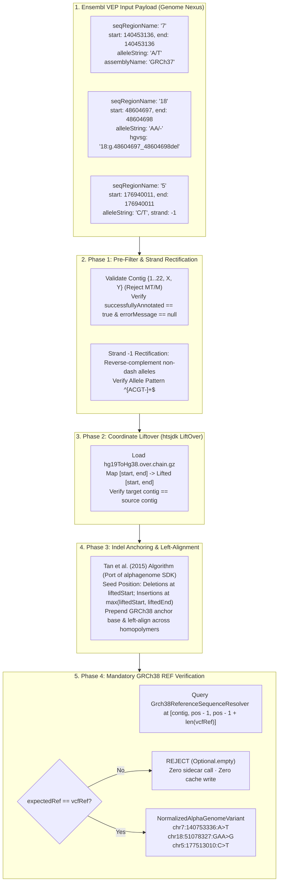

# Workstream Task A: Normalization Logic Correctness Verification (`normalization-verification`)

- **Task ID**: `Task-A` (Approval-gated sub-steps `A.1` – `A.6`)
- **Skill**: `liftover-refcheck`, `cbioportal-annotation-cell`, `tdd`, `code-review`
- **Target Repositories**:
  - `workspace/genome-nexus` (Backend Normalizer & Reference Check)
  - `workspace/cbioportal-frontend` (Annotation Cell & Mutation Table UI Data View)
- **Live Ports**: Genome Nexus Backend (`:38080`), MongoDB (`:27017`), cBioPortal Frontend (`:3000`)
- **Language / Stack**: Java 11 / Spring Boot / `htsjdk` Samtools / TypeScript / React / MobX

---

## 1. Executive Summary & Verification Context

Variant normalization is the foundational safety boundary of the AlphaGenome integration. AlphaGenome only accepts **GRCh38** coordinates with a `chr` prefix and **VCF-style anchor-based alleles**, but critically, **the AlphaGenome API does not validate whether the reference allele matches the human genome**. If an incorrect reference base is provided, AlphaGenome will silently score the invalid sequence and generate spurious biological predictions.

Furthermore, Genome Nexus serves as the primary annotator for **cBioPortal**, which primarily consumes variants originating from **Ensembl VEP (Variant Effect Predictor)** in **GRCh37** coordinates. This verification task establishes formal proof that:
1. All variant shapes received from VEP (SNVs, MNVs, deletions, insertions, complex indels, reverse-strand transcripts) are correctly normalized and lifted to GRCh38 without corruption from transcript-level annotation conventions (e.g., VEP 3'-homopolymer shifting).
2. The reference sequence check strictly rejects mismatches against GRCh38 before any sidecar call or MongoDB cache write occurs.
3. Variants flowing from the **cBioPortal UI Data View** (Mutations tab across Study View, Patient View, and Results View) correctly surface in the `AlphaGenomeCell` annotation column.
4. **The Missing Spinner Defect**: Resolves the UX inconsistency where OncoKB, CIViC, and Hotspot show an active loading spinner while AlphaGenome displays an empty blank slot during asynchronous in-flight requests.

---

## 2. In-Depth Architecture: What VEP Input Means for Normalization



### 2.1 The Homopolymer & 3'-Shifting Trap
In standard HGVS and Ensembl VEP conventions, deletions and insertions within tandem repeats or homopolymers are shifted to the most **3'-position** relative to the transcript.
- Example: `SMAD4` `c.1520_1521del` (`18:g.48604697_48604698del` vs `18:g.48604696_48604697del` in GRCh37).
- VEP populates `hgvsg` using 3'-shifted coordinates.
- **Rule of Correctness**: `AlphaGenomeVariantNormalizer` **must never parse `VariantAnnotation.getHgvsg()`**. It must strictly parse genomic fields (`seqRegionName`, `start`, `end`, `alleleString`), lift the raw genomic interval to GRCh38, fetch the 1-bp anchor base from GRCh38 FASTA, and apply left-alignment (5'-shifting on the positive strand) via Tan et al. (2015).

### 2.2 Insertion Flank Seeding Asymmetry
In VEP / Genome Nexus, insertions have `alleleString = "-/T"` and often store coordinates where `end = start - 1` or inverted spans.
- The SDK `normalize_variant` loop begins with a left-extension (`position -= 1`) whenever an allele is empty.
- Seeding deletions at `liftedStart` works naturally because the reference base is present.
- **Seeding insertions at `Math.min(liftedStart, liftedEnd)` shifts the anchor base one position too far left**.
- **Correctness Rule**: Insertions must be seeded at the right-flank coordinate:
  $$\text{seedPos} = \max(\text{liftedStart}, \text{liftedEnd})$$
  This guarantees the first left-extension pass lands precisely on the true 1-bp upstream anchor base.

### 2.3 Strict Rejection Guarantee
If `expectedRef` extracted from the GRCh38 FASTA does not match `vcfRef` case-insensitively:
- The normalizer emits `PHASE 2: GRCH38 REF CHECK REJECTED`.
- Returns `Optional.empty()`.
- Prevents downstream dispatch to the sidecar (`CachedAlphaGenomeFetcher`) and avoids inserting corrupt entries into MongoDB `alphagenome.annotation`.

---

## 3. The cBioPortal UI Data View Consideration & The Missing Spinner Defect

### 3.1 What a User Browses to Land on AlphaGenome
In cBioPortal, users explore variants through three main data views:
1. **Study View (Mutations Tab)**: e.g., TCGA Pancreatic Adenocarcinoma (`PAAD`), viewing all somatic mutations across the cohort.
2. **Results View**: Multi-gene OncoQuery queries (e.g., `KRAS`, `TP53`, `SMAD4`, `CDKN2A`), comparing mutation frequencies, co-occurrence, and functional impacts.
3. **Patient View (Mutations Tab)**: Clinical sample-level variant lists for an individual patient.

In all three views, the mutations table renders the **Annotation** column (`GenericAnnotation` in `packages/react-mutation-mapper/src/component/column/Annotation.tsx`).

```
┌────────────────────────────────────────────────────────────────────────────────────────┐
│ Mutations Table - Annotation Column View                                               │
├─────────┬──────────────┬──────────────┬────────────────────────────────────────────────┤
│ Gene    │ Alteration   │ Type         │ Annotations                                    │
├─────────┼──────────────┼──────────────┼────────────────────────────────────────────────┤
│ BRAF    │ V600E        │ Missense     │ [OncoKB] [CIViC] [Hotspot] [reVUE] [αG strong] │
│ SMAD4   │ c.1520_del   │ In_Frame_Del │ [OncoKB] [CIViC] [Hotspot] [    ] [αG mod]    │
│ TP53    │ R175H        │ Missense     │ [OncoKB] [CIViC] [Hotspot] [    ] [αG strong] │
│ MUC16   │ A123T (Cold) │ Missense     │ [OncoKB] [CIViC] [Hotspot] [    ] [ ⟳ SPINNER] │ <-- DEFECT GAP
└─────────┴──────────────┴──────────────┴────────────────────────────────────────────────┘
```

### 3.2 Analysis of the Missing Spinner Defect
A critical UX flaw exists in the current cBioPortal implementation:
- **OncoKB**: Passes `status={annotation.oncoKbStatus}`. While data is fetching, it renders an animated spinner.
- **CIViC**: Passes `civicStatus={annotation.civicStatus}`. If `'pending'`, it renders `loaderIcon('pull-left')`.
- **Hotspot**: Passes `status={annotation.hotspotStatus}`. If `'pending'`, it renders `loaderIcon('pull-left')`.
- **AlphaGenome (`AlphaGenomeCell`)**:
  - `GenericAnnotation` calls `<AlphaGenomeCell annotation={annotation.alphaGenome} />`.
  - Notice that `AlphaGenomeCell` does **not** accept a `status` prop (`status?: 'pending' | 'error' | 'complete'`)!
  - In `Annotation.tsx`, while `indexedAlphaGenomeAnnotations.isPending` is true, `annotation.alphaGenome` is `undefined`.
  - Inside `AlphaGenomeCell`:
    ```typescript
    const label = alphaGenomeLabel(props.annotation, displayCurie);
    if (!label) {
        return <span className={`${annotationStyles['annotation-item']}`} />;
    }
    ```
  - **The Symptom**: When a user queries cold variants, AlphaGenome inference takes 1–3 seconds per variant. During this entire loading period, the cell renders `<span className="annotation-item" />` (a blank empty slot).
  - Clinicians perceive that AlphaGenome has "no data" or failed, until the badge abruptly pops in seconds later. If the variant is rejected or unscored, it remains blank. The user cannot distinguish between **in-flight scoring** and **negative/unscored results**.

---

## 4. Approval-Gated Implementation & Verification Sub-Steps

Muse must execute the following sub-steps sequentially, stopping for user approval after each step.

### Step `A.1`: Audit & Formalize VEP Input Shapes
- **Goal**: Confirm and catalog all VEP annotation inputs supported by Genome Nexus.
- **Action**:
  1. Inspect `model/src/main/java/org/cbioportal/genome_nexus/model/VariantAnnotation.java` and `TranscriptConsequence.java`.
  2. Verify input matrix:
     - Standard SNV: `7:g.140453136A>T` (`alleleString: "A/T"`).
     - Deletion: `18:g.48604697_48604698del` (`alleleString: "AA/-"`).
     - Insertion: `alleleString: "-/T"`.
     - Multi-nucleotide variant: `alleleString: "CG/TA"`.
     - Reverse-strand variant (`strand = -1`).
  3. Document the exact extraction of canonical transcript fields (`geneId`, `geneSymbol`) via `CanonicalTranscriptResolver`.
- **Done When**: VEP input catalog is verified and approved.

### Step `A.2`: Verify Indel Anchoring & Homopolymer Left-Alignment
- **Goal**: Formally test that Tan et al. (2015) left-alignment in `AlphaGenomeVariantNormalizer` produces correct VCF anchor bases without 3'-shifting.
- **Action**:
  1. Inspect `AlphaGenomeVariantNormalizer.normalizeAlleles()`.
  2. Test `SMAD4` deletion `18:g.48604697_48604698del` (`seqRegionName="18"`, `start=48604697`, `end=48604698`, `alleleString="AA/-"`, `assemblyName="GRCh37"`).
  3. Verify it lifts to `chr18`, prepends `G` from GRCh38 FASTA at `pos = 51078327`, yielding `chr18:51078327:GAA>G`.
  4. Test insertion `alleleString="-/A"` at `start=100, end=99` to ensure `seedPos = Math.max(100, 99) = 100` and correctly extends to anchor at `99`.
- **Done When**: Unit tests in `AlphaGenomeVariantNormalizerTest` pass for all indel geometries.

### Step `A.3`: Verify GRCh38 FASTA Reference Check Rejection
- **Goal**: Ensure that wrong-REF variants are strictly rejected before hitting the sidecar or cache.
- **Action**:
  1. Inject synthetic test variants with artificial REF mismatches:
     - `chr5:177513010:G>T` (GRCh38 has `C` at this locus).
     - `chr7:140753336:T>A` (GRCh38 has `A` at this locus).
  2. Verify `AlphaGenomeVariantNormalizer.normalize()` returns `Optional.empty()`.
  3. Verify that `CachedAlphaGenomeFetcher` receives 0 requests and MongoDB collection `alphagenome.annotation` receives 0 writes for these variants.
- **Done When**: Maven tests verify 100% rejection rate for REF-mismatched variants.

### Step `A.4`: Rectify Missing Loading Spinner in cBioPortal Frontend
- **Goal**: Upgrade `AlphaGenomeCell` and `Annotation.tsx` to display an animated spinner while `alphaGenomeAnnotations` is pending, matching OncoKB, CIViC, and Hotspot.
- **Action**:
  1. In `packages/react-mutation-mapper/src/component/column/Annotation.tsx`:
     - Add `alphaGenomeStatus: RemoteDataStatus` to `IAnnotation`.
     - Set `alphaGenomeStatus = indexedAlphaGenomeAnnotations ? indexedAlphaGenomeAnnotations.status : 'pending'`.
     - Pass `status={annotation.alphaGenomeStatus}` into `AlphaGenomeCell`.
  2. In `packages/react-mutation-mapper/src/component/alphagenome/AlphaGenome.tsx`:
     - Update props interface:
       ```typescript
       export interface IAlphaGenomeCellProps {
           annotation?: AlphaGenomeAnnotation;
           cancerType?: string;
           ontologyCurie?: string;
           status?: 'pending' | 'error' | 'complete';
       }
       ```
     - When `props.status === 'pending'`, render `loaderIcon('pull-left')`.
     - When `props.status === 'complete'` and no dual-gate label passes, render `<span className="annotation-item" />`.
     - When passing dual-gate, render the `αG` badge with `DefaultTooltip`.
- **Done When**: Mutation table displays a clear spinner during cold fetch, smoothly transitioning to the `αG` badge or empty slot upon completion.

### Step `A.5`: End-to-End Test in cBioPortal UI Data View
- **Goal**: Validate that browsing a real cohort in cBioPortal triggers the correct normalization pipeline and renders annotations accurately.
- **Action**:
  1. Test TCGA PAAD cohort query (`KRAS`, `TP53`, `SMAD4`, `CDKN2A`).
  2. Monitor live trace log `/Users/dixitpatel/Documents/Personal-Dev-Workspace/Meta_hackathon/workspace/logs/alphagenome_pipeline_debug.log`:
     - Verify `PHASE 1: PRE-FILTER PASSED`.
     - Verify `PHASE 2: LIFTOVER SUCCESS` (GRCh37 $\rightarrow$ GRCh38).
     - Verify `PHASE 2: GRCH38 REF CHECK PASSED`.
     - Verify `PHASE 2: NORMALIZATION COMPLETE`.
  3. Verify that the cBioPortal UI data view shows:
     - Active spinner while in flight.
     - Strong/moderate `αG` badge with OncoTree tissue mapping (`PAAD` $\rightarrow$ `UBERON:0001264`).
- **Done When**: End-to-end trace verifies 0 errors and frontend displays annotations properly.

### Step `A.6`: Code Review & Sign-Off
- **Action**: Run `git diff` across `workspace/genome-nexus` and `workspace/cbioportal-frontend`, confirm zero unintended side effects, and verify test suites pass cleanly.
- **Done When**: Reviewer approves code changes.

---

## 5. Verification Commands

```bash
# 1. Run Genome Nexus Normalizer Test Suite
export JAVA_HOME="/opt/homebrew/opt/openjdk@11/libexec/openjdk.jdk/Contents/Home"
export PATH="$JAVA_HOME/bin:/opt/homebrew/bin:$PATH"
cd /Users/dixitpatel/Documents/Personal-Dev-Workspace/Meta_hackathon/workspace/genome-nexus
mvn test -Dtest=AlphaGenomeVariantNormalizerTest -pl component -B

# 2. Run cBioPortal Frontend Package Tests
export PATH="/Users/dixitpatel/Documents/Personal-Dev-Workspace/Meta_hackathon/agentic-setup/bin/node-v22.18.0-darwin-arm64/bin:/opt/homebrew/bin:$PATH"
cd /Users/dixitpatel/Documents/Personal-Dev-Workspace/Meta_hackathon/workspace/cbioportal-frontend
pnpm --filter react-mutation-mapper run build
pnpm --filter react-mutation-mapper run test

# 3. Test Live Variant Normalization via Backend
curl -s "http://localhost:38080/annotation/7:g.140453136A%3ET?fields=alpha_genome" | jq .
curl -s "http://localhost:38080/annotation/18:g.48604697_48604698del?fields=alpha_genome" | jq .
```
