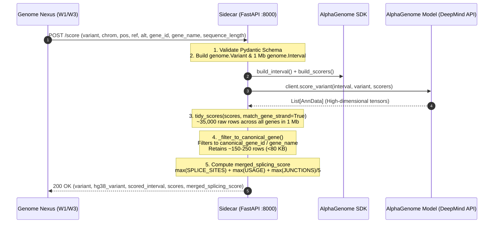

# Workstream Task B: Sidecar Logic Correctness Verification (`sidecar-verification`)

- **Task ID**: `Task-B` (Approval-gated sub-steps `B.1` – `B.6`)
- **Skill**: `alphagenome-sidecar`, `alphagenome-terms`, `tdd`, `code-review`
- **Target Repositories**:
  - `workspace/alphagenome-sidecar` (FastAPI Scoring Service & SDK Integration)
  - `workspace/genome-nexus` (Client Dispatcher & Schema Compatibility)
- **Live Ports**: AlphaGenome Sidecar (`:8000`), Genome Nexus Backend (`:38080`)
- **Language / Stack**: Python 3.13 / FastAPI / Uvicorn / AlphaGenome SDK 0.10.0 / Pandas / Pytest

---

## 1. Executive Summary & Verification Context

The AlphaGenome Sidecar acts as the bridge between the Java-based Genome Nexus backend and DeepMind's official AlphaGenome Python SDK. AlphaGenome is a transformer model predicting gene expression and splicing variations directly from 1 Mb of raw genomic sequence.

This task provides exhaustive correctness verification of the sidecar's internal logic, including:
1. **Contract Adherence**: Validating that incoming `ScoreRequest` JSON payloads from Genome Nexus adhere strictly to `workstreams/contracts/sidecar_openapi.yaml`.
2. **Receptive Field Construction**: Ensuring sequence intervals (1 Mb default) center symmetrically around variants while guarding chromosome boundaries (`start < 0`).
3. **Scorer Composition & Execution**: Verifying that the 4 recommended variant scorers (`RNA_SEQ`, `SPLICE_SITES`, `SPLICE_SITE_USAGE`, `SPLICE_JUNCTIONS`) execute properly against the model.
4. **Post-Inference Filtering**: Verifying that `tidy_scores` unpacks AnnData tensors with `match_gene_strand=True`, and reduces 30,000–38,000 raw rows to the canonical gene's tracks (~100–300 rows), preventing MongoDB 16 MB BSON overflow and payload bloat.
5. **Merged Splicing Score Correctness**: Mathematically verifying the composite splice disruption score.
6. **Dual-Gate Alignment**: Verifying that track scores satisfy the cBioPortal frontend dual-gate threshold requirements across OncoTree-to-UBERON tissue mappings.

---

## 2. Architecture & Data Flow in the Scoring Sidecar



---

## 3. Core Logic Deep Dive & Invariant Checks

### 3.1 Genomic Boundary Clamping
AlphaGenome evaluates a $1{,}048{,}576$ bp ($2^{20}$ bp) sequence window.
- The SDK `reference_interval.resize(sequence_length)` centers symmetrically around `position`.
- For telomeric variants (e.g. variants within the first $524{,}288$ bp of chromosome 1), unconstrained centering produces a negative start coordinate (`interval.start < 0`), which the upstream DeepMind model server rejects with 400 Bad Request.
- **Invariant**: The sidecar clamps negative boundaries:
  ```python
  if interval.start < 0:
      interval = genome.Interval(interval.chromosome, 0, sequence_length)
  ```

### 3.2 Post-Inference Tidy & Gene Filtering (Preventing MongoDB BSON Overflow)
In a 1 Mb window, human chromosomes contain between 15 and 60 distinct genes. When AlphaGenome runs its 4 scorers across all genes in the interval:
- Raw `tidy_scores` outputs **30,000 to 38,000 rows** per variant.
- In JSON serialization, 38,000 rows consume **~15 to 22 MB**.
- MongoDB's hard maximum BSON document limit is **16 MB**. Writing an unfiltered payload causes an immediate `BSONObjectTooLarge` fatal exception in Genome Nexus.
- **Filtering Invariant**:
  ```python
  matches_name = tidy["gene_name"] == gene_name
  if gene_id:
      gene_id = gene_id.split(".")[0]
      matches = (tidy["gene_id"] == gene_id) | matches_name
  else:
      matches = matches_name
  filtered = tidy[matches]
  ```
  This reduces row count to **100–300 rows**, reducing payload size to **~50–80 KB** ($< 0.5\%$ of the BSON limit).

### 3.3 Merged Splicing Score Formula Verification
To provide clinicians with an instantaneous gauge of overall splicing impact, the sidecar aggregates all splicing scorers into a single normalized composite metric:
$$\text{merged\_splicing\_score} = \max(\text{SPLICE\_SITES}) + \max(\text{SPLICE\_SITE\_USAGE}) + \frac{\max(\text{SPLICE\_JUNCTIONS})}{5.0}$$

- **Verification Properties**:
  - `SPLICE_SITES`: Measures donor/acceptor site disruption (raw score typically between $0.0$ and $1.0$).
  - `SPLICE_SITE_USAGE`: Measures changes in exon inclusion/exclusion.
  - `SPLICE_JUNCTIONS`: Measures de novo junction counts; divided by $5.0$ to scale proportionally with site scores.
  - If any scorer output type is absent or `NaN`, `numeric_only=True` prevents `TypeError`, and if all splicing scores are empty, the formula cleanly yields `None` (`null` in JSON).

### 3.4 Dual-Gate Alignment with cBioPortal Frontend
The sidecar scores are rendered in the cBioPortal mutations table and must satisfy the dual-gate criteria:
1. **Mandatory Quantile Gate**:
   $$|\text{quantile\_score}| \ge 0.99$$
   (Ensures score falls within the top $1\%$ of the genome-wide impact distribution).
2. **Raw Score Gate**:
   - `RNA_SEQ`:
     - Strong: $|\text{raw\_score}| \ge 0.5$ ($\approx 1.5\times$ fold change).
     - Moderate: $|\text{raw\_score}| \ge 0.1$.
   - Splicing tracks (`SPLICE_SITES`, `SPLICE_SITE_USAGE`, `SPLICE_JUNCTIONS`):
     - Strong: $\text{raw\_score} \ge 0.5$.
     - Moderate: $\text{raw\_score} \ge 0.2$.
3. **Tissue Context**:
   - `SPLICE_SITES`: Evaluated across all tissues (tissue-agnostic; `ontology_curie = None`).
   - `RNA_SEQ` & usage: Evaluated against the study's specific tissue CURIE (e.g. `UBERON:0001264` for pancreas/PAAD).

---

## 4. Approval-Gated Implementation & Verification Sub-Steps

### Step `B.1`: Audit Sidecar Contract & Pydantic Validation
- **Goal**: Verify that `POST /score` rejects malformed payloads and adheres to `sidecar_openapi.yaml`.
- **Action**:
  1. Inspect `app/schemas.py` and `app/main.py`.
  2. Verify validation rules:
     - Reject missing fields (`chromosome`, `position`, `reference_allele`, `alternate_allele`, `canonical_gene`).
     - Enforce `sequence_length` allowlist (`16384`, `131072`, `524288`, `1048576`); reject any other integer with HTTP 422.
     - Reject unknown scorer names with HTTP 422.
- **Done When**: Pydantic schema validation tests pass with 100% compliance.

### Step `B.2`: Verify Boundary Clamping & Interval Generation
- **Goal**: Verify that `build_interval` handles telomeric variants without negative coordinates.
- **Action**:
  1. Test telomeric variant: `chr1:5000:A>G` with `sequence_length = 1048576`.
  2. Confirm `interval.start == 0` and `interval.end == 1048576`.
  3. Test standard variant: `chr7:140753336:A>T`. Confirm interval is centered at $[140229048, 141277624]$.
- **Done When**: Unit tests in `tests/test_scoring.py` pass for all boundary cases.

### Step `B.3`: Verify Tidy Scores Strand Matching & Canonical Gene Filtering
- **Goal**: Prove that gene filtering reduces AnnData rows by $>98\%$ while retaining accurate strand alignment.
- **Action**:
  1. Mock or execute `score_variant` for `BRAF` V600E (`chr7:140753336:A>T`, `canonical_gene="BRAF"`).
  2. Verify `tidy_scores` was invoked with `match_gene_strand=True`.
  3. Assert `len(tidy) > 25000` before filtering, and `len(filtered) < 500` after filtering.
  4. Assert all retained rows contain `gene_name == "BRAF"` or `gene_id == "ENSG00000157764"`.
- **Done When**: Filtering logic tests pass and confirm document size remains $< 100$ KB.

### Step `B.4`: Verify Merged Splicing Score Mathematical Computation
- **Goal**: Formally test the merged splicing score function across edge cases.
- **Action**:
  1. Create synthetic DataFrame test cases:
     - Normal case: `SPLICE_SITES = 0.6`, `SPLICE_SITE_USAGE = 0.3`, `SPLICE_JUNCTIONS = 1.0` $\rightarrow 0.6 + 0.3 + 0.2 = 1.1$.
     - Missing junction scorer: `SPLICE_SITES = 0.8`, `SPLICE_SITE_USAGE = 0.4` $\rightarrow 0.8 + 0.4 + 0.0 = 1.2$.
     - All splicing empty: only `RNA_SEQ` present $\rightarrow$ returns `None`.
     - Presence of `NaN` or negative values.
  2. Confirm output matches formula with floating point precision.
- **Done When**: Pytest unit tests pass with 0 assertion errors.

### Step `B.5`: Verify UBERON Ontological Curie Propagation
- **Goal**: Confirm tissue CURIEs are cleanly propagated for cBioPortal frontend matching.
- **Action**:
  1. Verify rows for `RNA_SEQ` include valid `ontology_curie` (e.g., `UBERON:0001264`, `UBERON:0002097`).
  2. Verify `SPLICE_SITES` rows have `ontology_curie == None` (tissue-agnostic).
  3. Verify optional `ontology_curies` request parameter filters DataFrame rows when specified.
- **Done When**: Ontology filtering tests pass.

### Step `B.6`: Upstream Error Handling & Health Check Verification
- **Goal**: Ensure sidecar correctly maps gRPC rate limits and upstream disconnects to HTTP status codes.
- **Action**:
  1. Verify gRPC `RESOURCE_EXHAUSTED` raises HTTP 429 (`RateLimitedError`).
  2. Verify missing API key or upstream network failure raises HTTP 503 (`UpstreamUnavailableError`).
  3. Verify `GET /health` returns HTTP 200 `{"status": "ok", "service": "alphagenome-sidecar"}`.
- **Done When**: Reviewer approves sidecar verification report.

---

## 5. Verification Commands

```bash
# 1. Run Sidecar Pytest Suite with Coverage
cd /Users/dixitpatel/Documents/Personal-Dev-Workspace/Meta_hackathon/workspace/alphagenome-sidecar
/Users/dixitpatel/Documents/Personal-Dev-Workspace/Meta_hackathon/agentic-setup/.venv/bin/python -m pytest tests/ -v

# 2. Check Sidecar Health Endpoint
curl -s http://localhost:8000/health | jq .

# 3. Direct Sidecar Scoring Smoke Test (BRAF V600E)
curl -s -X POST http://localhost:8000/score \
  -H "Content-Type: application/json" \
  -d '{
    "variant": "7:g.140453136A>T",
    "chromosome": "chr7",
    "position": 140753336,
    "reference_allele": "A",
    "alternate_allele": "T",
    "canonical_gene_id": "ENSG00000157764",
    "canonical_gene": "BRAF"
  }' | jq '{variant, hg38_variant, canonical_gene, merged_splicing_score, score_count: (.scores | length)}'
```
